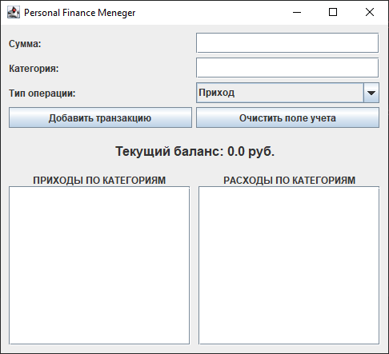

# FinanceMeneger
## Цель

Цель этого проекта — создать простое и удобное десктопное приложение для управления личными финансами и аналитики расходов, с помощью Java, SQLite и Java Swing.

---

## Главная форма



---

## Ключевые особенности и функционал

- Учет транзакций: Быстрое добавление доходов (Приход) и расходов (Расход) с указанием суммы и категории.
- Локальное хранение данных: Использование встроенной реляционной СУБД SQLite.
- Данные сохраняются автоматически в файл `finance.db` в корне проекта и не теряются при перезапуске приложения.
- Перерасчет общего финансового баланса в на основе всей истории транзакций.
- Автоматическая суммирование всех затрат по введенным категориям для наглядного контроля бюджета.

---

##  Стек технологий

- Язык программирования: Java (JDK 24)
- Графический интерфейс (GUI): Java Swing (AWT)
- База данных и подключение: SQL, SQLite, JDBC (драйвер `sqlite-jdbc`)
- Сборщик проектов: Apache Maven

---

## Локальный запуск

### Требования
- Установленная **JDK 17** или выше.
- Настроенный менеджер зависимостей **Maven**.

### Инструкция по запуску
1. Склонируйте репозиторий к себе на компьютер:
   ```bash
   git clone https://github.com/Tunna-fish/FinanceMeneger.git
   ```
2. Откройте проект в IntelliJ IDEA.
3. Дождитесь, пока Maven автоматически загрузит необходимые зависимости из файла `pom.xml`.
4. Перейдите по пути: `src/main/java/org/example/ui/FinanceAppUI.java`.
5. Запустите метод main.

---
